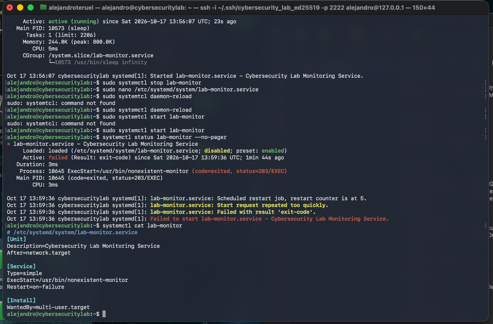

# Incident 001 — Linux Systemd Service Failure

## Incident Summary

| Field | Details |
|---|---|
| Incident ID | LAB-001 |
| Category | Linux Service Management |
| Environment | Ubuntu Server 24.04.5 LTS |
| Affected service | `lab-monitor.service` |
| Severity | Low — Controlled Lab |
| Status | Resolved |
| Incident type | Simulated service failure |

## 1. Problem Description

During a Linux system administration troubleshooting exercise, a custom systemd service failed to start.

The service, `lab-monitor.service`, was originally configured to run a simple background process.

To simulate a realistic configuration failure, the service's executable path was intentionally changed to a nonexistent program.

The objective was to investigate the failure using Linux administration tools, identify the root cause, restore the service, and verify its recovery.

## 2. Expected Behavior

The service was expected to start successfully and remain active.

Its original configuration included:

```ini
[Unit]
Description=Cybersecurity Lab Monitoring Service
After=network.target

[Service]
Type=simple
ExecStart=/usr/bin/sleep infinity
Restart=on-failure

[Install]
WantedBy=multi-user.target
```

The service initially reported:

```text
Active: active (running)
```

## 3. Observed Failure

After changing the executable path, the service failed to start.

The following command was used to investigate its status:

```bash
systemctl status lab-monitor --no-pager
```

The output included:

```text
Active: failed (Result: exit-code)
status=203/EXEC
Start request repeated too quickly
```

The `203/EXEC` status indicated that systemd could not execute the configured program.

The repeated-start warning showed that systemd had attempted to restart the service before reaching its restart limit.

## 4. Investigation

The service configuration was inspected using:

```bash
systemctl cat lab-monitor
```

The following incorrect directive was identified:

```ini
ExecStart=/usr/bin/nonexistent-monitor
```

The configured executable did not exist.

Systemd was therefore unable to launch the process successfully.

The service's failure status and configuration were used together to determine the cause.

## 5. Root Cause

**Incorrect executable path in the systemd service configuration.**

The `ExecStart` directive pointed to a nonexistent program.

This prevented systemd from executing the service and caused the service startup to fail.

## 6. Resolution

The configuration file was opened:

```bash
sudo nano /etc/systemd/system/lab-monitor.service
```

The incorrect directive was replaced with the original valid command:

```ini
ExecStart=/usr/bin/sleep infinity
```

After saving the configuration, the following commands were executed:

```bash
sudo systemctl daemon-reload
sudo systemctl reset-failed lab-monitor
sudo systemctl start lab-monitor
```

`daemon-reload` made systemd reload the updated unit definition.

`reset-failed` cleared the recorded failed state and restart-limit information.

The service was then started again.

## 7. Verification

The service was checked using:

```bash
systemctl status lab-monitor --no-pager
```

The result was:

```text
Active: active (running)
```

The service successfully returned to its expected operational state.

**Final status: Resolved.**

## 8. Lessons Learned

- A service failure should be investigated before making changes.
- `systemctl status` provides useful information about service health.
- The `203/EXEC` error can indicate a problem executing the configured program.
- `systemctl cat` helps inspect service definitions.
- Changes to systemd unit files require `daemon-reload`.
- A repaired service must be started and verified before considering an incident resolved.

## 9. Security and Operational Relevance

Incorrect service configurations can cause outages and disrupt normal system operations.

In a production environment, diagnosing service failures quickly helps reduce downtime and supports system availability.

This exercise demonstrated a structured troubleshooting workflow:

**Identify failure → Inspect evidence → Determine root cause → Apply fix → Verify recovery.**

## 10. Evidence



The screenshot shows the simulated service failure, relevant error messages, and the incorrect `ExecStart` configuration.

---

*This incident was intentionally simulated in a controlled educational Linux environment. No production systems were affected.*