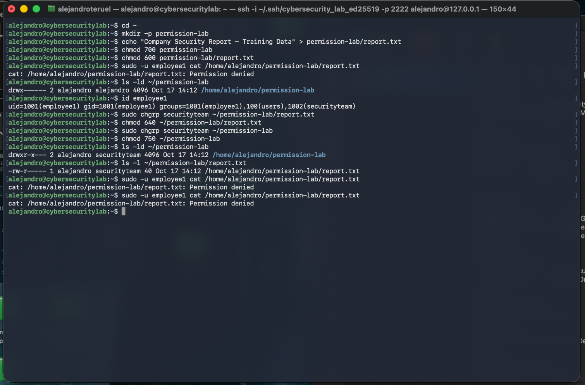
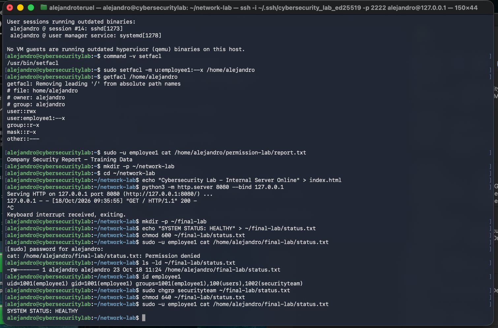

# Incident 002 — Linux File Permission Denied

## Incident Summary

| Field | Details |
|---|---|
| Incident ID | LAB-002 |
| Category | Linux File Permissions & Access Control |
| Environment | Ubuntu Server 24.04.5 LTS |
| Affected user | `employee1` |
| Affected resource | `/home/alejandro/permission-lab/report.txt` |
| Severity | Low — Controlled Lab |
| Status | Resolved |
| Incident type | Simulated access-control failure |

## 1. Problem Description

During a simulated Linux administration incident, a user named `employee1` was unable to read a company security report.

The objective was to investigate the access failure, identify the permissions preventing access, and restore read-only access without unnecessarily exposing other files.

The test user was already a member of the `securityteam` group.

## 2. Observed Failure

The following command was executed to reproduce the incident:

```bash
sudo -u employee1 cat /home/alejandro/permission-lab/report.txt
```

The result was:

```text
cat: /home/alejandro/permission-lab/report.txt: Permission denied
```

This confirmed that the test account could not access the report.

## 3. Initial Investigation

File and directory permissions were inspected using:

```bash
ls -ld /home/alejandro/permission-lab
ls -l /home/alejandro/permission-lab/report.txt
id employee1
```

Initial permissions were configured as follows:

| Resource | Permissions | Meaning |
|---|---|---|
| `permission-lab/` | `700` | Owner-only access |
| `report.txt` | `600` | Owner read/write only |

The file and directory were initially owned by `alejandro`, with group ownership assigned to `alejandro`.

The `employee1` account belonged to the `securityteam` group, but that membership did not automatically grant access to resources belonging to a different group.

## 4. First Remediation Attempt

The group ownership of the report was changed:

```bash
sudo chgrp securityteam ~/permission-lab/report.txt
chmod 640 ~/permission-lab/report.txt
```

The directory was also assigned to the security group:

```bash
sudo chgrp securityteam ~/permission-lab
chmod 750 ~/permission-lab
```

The resulting permissions were:

```text
drwxr-x--- alejandro securityteam permission-lab
-rw-r----- alejandro securityteam report.txt
```

Despite these changes, `employee1` still received:

```text
Permission denied
```

This indicated that the problem was not limited to the report and its immediate parent directory.

## 5. Root Cause Investigation

The permissions of the administrator's home directory were inspected:

```bash
ls -ld /home/alejandro
```

The output showed:

```text
drwxr-x--- alejandro alejandro
```

The home directory did not grant access to other users through its ordinary Unix permission bits.

Although `employee1` belonged to `securityteam`, the account was not a member of the `alejandro` group.

Linux requires appropriate directory traversal permissions on every directory leading to a file.

Therefore, `employee1` was blocked at `/home/alejandro` before it could reach the report.

### Root Cause

**Missing directory traversal permission on an intermediate directory.**

The report's own permissions had been corrected, but the user still lacked the ability to traverse the administrator's home directory.

## 6. Final Resolution

Instead of broadly changing the home directory permissions, a targeted Access Control List (ACL) was used.

The following command granted `employee1` directory traversal permission:

```bash
sudo setfacl -m u:employee1:--x /home/alejandro
```

The ACL was inspected using:

```bash
getfacl /home/alejandro
```

The relevant entry was:

```text
user:employee1:--x
```

This allowed `employee1` to traverse the specified directory without granting directory-listing permission.

The report remained read-only for members of `securityteam`.

## 7. Verification

The original access test was repeated:

```bash
sudo -u employee1 cat /home/alejandro/permission-lab/report.txt
```

This time, the result was:

```text
Company Security Report - Training Data
```

The user successfully read the report.

**Final status: Resolved.**

## 8. Security Considerations

The solution applied the principle of least privilege.

Rather than granting broad access to the home directory, a specific ACL entry was created for the affected user.

The report's group permissions allowed reading without granting group write permission.

It is also important to distinguish file permissions from directory permissions: deleting or renaming a file is primarily controlled by permissions on its parent directory.

## 9. Lessons Learned

- File access depends on permissions across the entire directory path.
- Group membership alone does not guarantee access to a file.
- `chmod` manages traditional Unix permissions.
- `chgrp` changes group ownership.
- ACLs enable more targeted access policies.
- Directory execute (`x`) permission permits traversal.
- Access should be tested again after remediation.
- Avoid granting unnecessary permissions simply to resolve an error.

## 10. Evidence

### Initial access failure



### Access restored



The screenshots document the initial failure, changes made to group ownership and access permissions, and successful access verification.

---

*This incident was simulated in a controlled Linux training environment. No production systems or confidential company data were involved.*