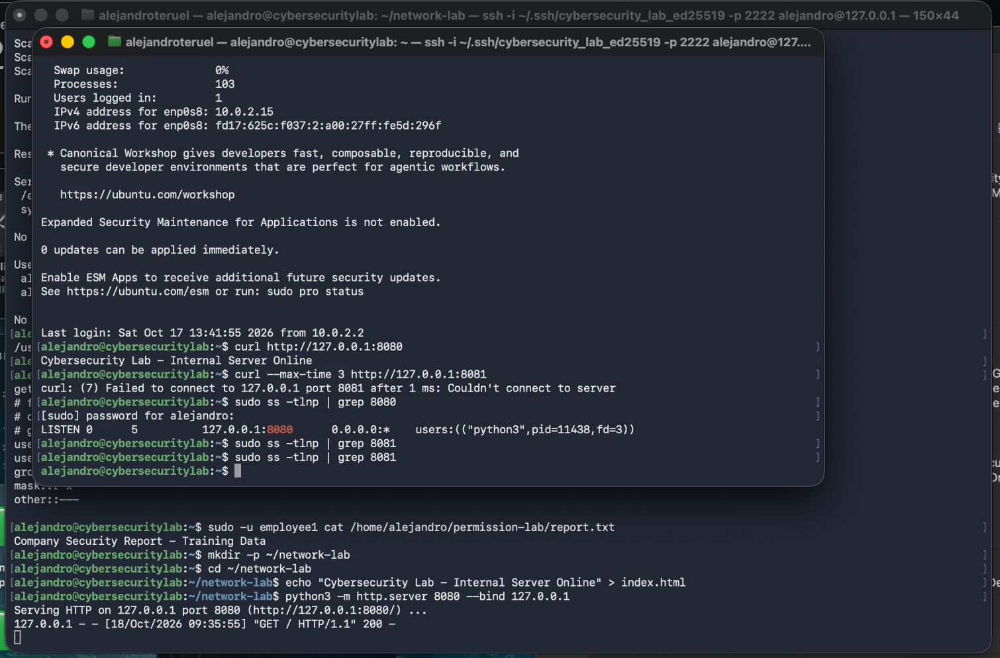

# Incident 003 — Network Connectivity Failure

## Incident Summary

| Field | Details |
|---|---|
| Incident ID | LAB-003 |
| Category | Linux Networking & Connectivity |
| Environment | Ubuntu Server 24.04.5 LTS |
| Affected application | Python HTTP test server |
| Expected service port | TCP 8080 |
| Incorrect client port | TCP 8081 |
| Severity | Low — Controlled Lab |
| Status | Resolved |
| Incident type | Simulated network configuration error |

## 1. Problem Description

During a simulated network troubleshooting incident, an internal web application appeared to be unreachable.

The application was running on an Ubuntu Server virtual machine, but the client attempted to connect through an incorrect TCP port.

The objective was to determine whether the issue originated from the application, the listening network socket, or the client's connection configuration.

## 2. Lab Setup

A temporary HTTP server was created using Python's built-in web server.

A test directory and webpage were prepared:

```bash
mkdir -p ~/network-lab
cd ~/network-lab
echo "Cybersecurity Lab - Internal Server Online" > index.html
```

The server was started using:

```bash
python3 -m http.server 8080 --bind 127.0.0.1
```

The application listened on TCP port `8080`, bound to the Ubuntu loopback address.

Binding to `127.0.0.1` meant the service accepted connections originating from the same network namespace rather than listening on all network interfaces.

## 3. Observed Failure

A client attempted to connect through TCP port `8081`:

```bash
curl --max-time 3 http://127.0.0.1:8081
```

The command returned an error resembling:

```text
curl: (7) Failed to connect to 127.0.0.1 port 8081
```

This confirmed that the client could not establish a connection to the requested endpoint.

## 4. Investigation

The application was tested using the expected port:

```bash
curl http://127.0.0.1:8080
```

The request succeeded:

```text
Cybersecurity Lab - Internal Server Online
```

The Python server also logged an HTTP `200` response, confirming that it handled the request successfully.

### Inspecting listening ports

The following commands were used:

```bash
sudo ss -tlnp | grep 8080
sudo ss -tlnp | grep 8081
```

The first command showed that Python was listening on:

```text
127.0.0.1:8080
```

The second command produced no matching output.

This demonstrated that a process was listening on port `8080`, but no listening TCP socket was observed on port `8081`.

## 5. Root Cause

**Client-side TCP port misconfiguration.**

The client attempted to access the application through port `8081`, although the server was configured to listen on port `8080`.

The application itself was functioning correctly.

The failure did not require changing the server's firewall or restarting the application.

## 6. Resolution

The client request was corrected to use the application's configured port:

```bash
curl http://127.0.0.1:8080
```

The corrected request successfully reached the server.

This resolved the simulated connectivity problem without modifying the application's configuration.

## 7. Verification

The following observations confirmed the resolution:

| Test | Result |
|---|---|
| HTTP request to port 8080 | Successful |
| HTTP response | 200 OK |
| HTTP request to port 8081 | Connection failed |
| Listening TCP socket on 8080 | Confirmed |
| Listening TCP socket on 8081 | Not observed |
| Application response | Expected content returned |

**Final status: Resolved.**

After completing the exercise, the temporary Python HTTP server was stopped using `Ctrl + C`.

## 8. Security and Operational Relevance

Understanding listening ports is essential when troubleshooting Linux servers and investigating network exposure.

A failed connection does not automatically indicate that a firewall is blocking traffic.

Possible causes include:

- An application listening on a different port
- An application that is not running
- Incorrect IP addressing
- Network routing problems
- Firewall restrictions
- A service bound to an unexpected network interface

In this incident, comparing successful and failed connection attempts with the output of `ss` isolated the problem to a client port mismatch.

## 9. Lessons Learned

- TCP connections require the correct destination IP address and port.
- `curl` can test HTTP application connectivity.
- `ss` identifies listening network sockets and associated processes.
- An absence of matching output can provide useful diagnostic evidence.
- HTTP status `200` indicates a successfully handled request.
- A connection failure should be investigated before modifying firewall settings.
- Troubleshooting should distinguish application problems from network configuration problems.

## 10. Evidence

### Network connectivity investigation



The screenshot demonstrates successful application access through port `8080`, the failed attempt through port `8081`, and the listening socket associated with the Python HTTP server.

---

*This incident was intentionally simulated in a controlled Linux lab. No production services or external systems were affected.*